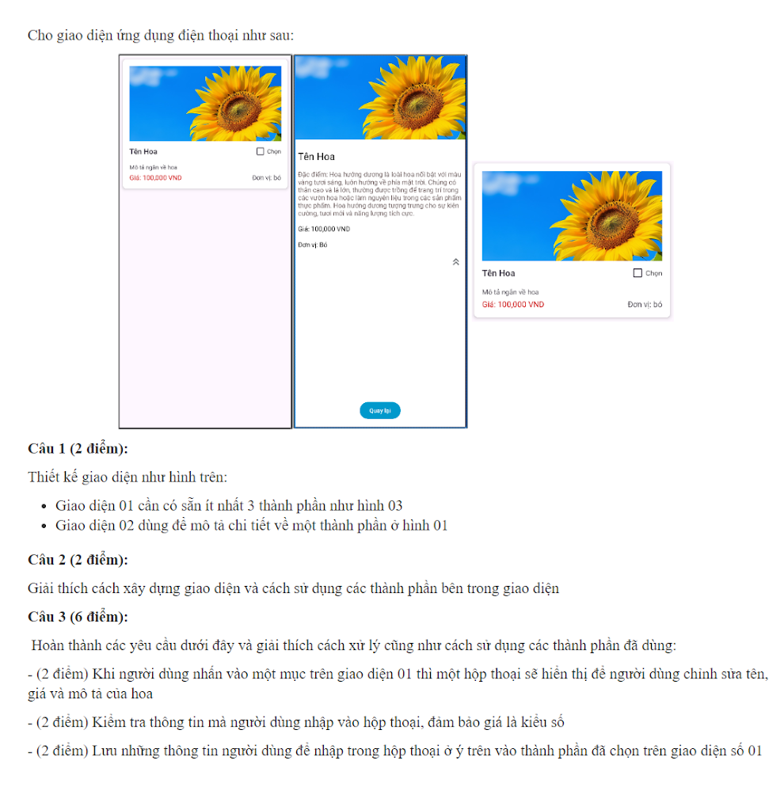
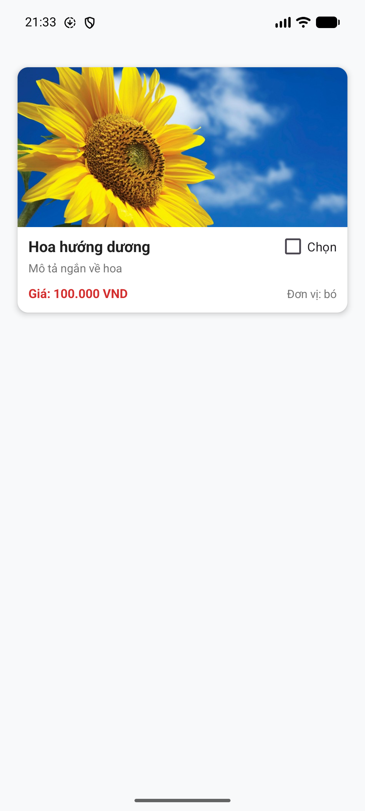
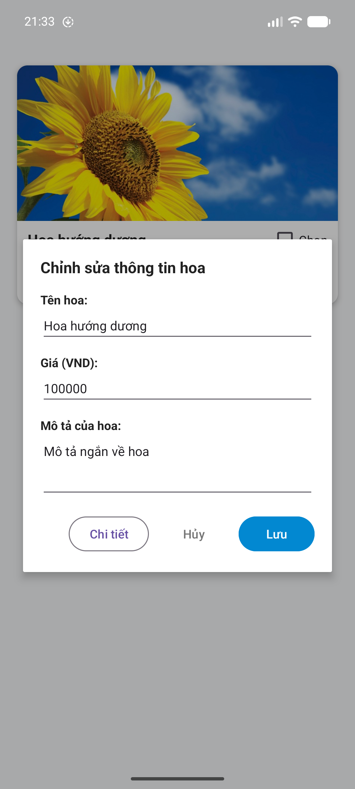
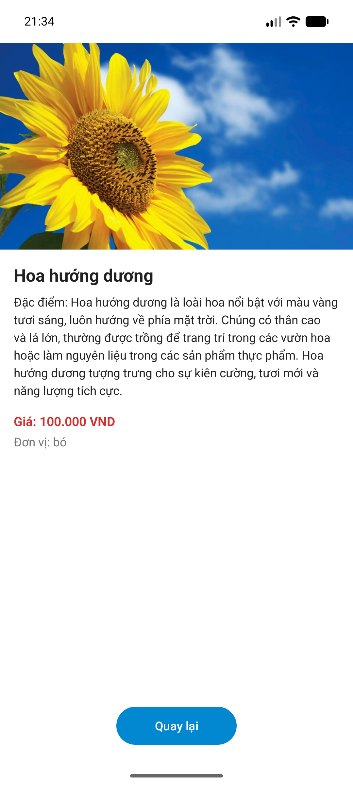

# 🌸 My Flower - Ứng Dụng Quản Lý & Giới Thiệu Các Loài Hoa

Ứng dụng Android viết bằng ngôn ngữ **Kotlin**, giải quyết trọn vẹn đề bài thực hành/thi lập trình di động Android gồm thiết kế giao diện danh sách, giao diện chi tiết, hộp thoại chỉnh sửa thông tin có kiểm tra hợp lệ dữ liệu (validation) và cập nhật thời gian thực.

---

## 📑 Mục Lục
1. [Nội Dung Đề Bài](#-nội-dung-đề-bài)
2. [Ảnh Chụp Ứng Dụng Thực Tế](#-ảnh-chụp-ứng-dụng-thực-tế)
3. [Các Tính Năng & Luồng Hoạt Động](#-các-tính-năng--luồng-hoạt-động)
4. [Công Nghệ & Kỹ Thuật Sử Dụng](#-công-nghệ--kỹ-thuật-sử-dụng)
5. [Cấu Trúc Thư Mục Dự Án](#-cấu-trúc-thư-mục-dự-án)
6. [Hướng Dẫn Cài Đặt & Chạy Ứng Dụng](#-hướng-dẫn-cài-đặt--chạy-ứng-dụng)

---

## 🎯 Nội Dung Đề Bài

<p align="center">
  
</p>

Cho giao diện ứng dụng điện thoại như thiết kế mẫu trên:

### **Câu 1:**
Thiết kế giao diện như hình:
- **Giao diện 01**: Cần có sẵn ít nhất 3 thành phần như hình 03.
- **Giao diện 02**: Dùng để mô tả chi tiết về một thành phần ở hình 01.

### **Câu 2:**
Giải thích cách xây dựng giao diện và cách sử dụng các thành phần bên trong giao diện.

### **Câu 3:**
Hoàn thành các yêu cầu dưới đây và giải thích cách xử lý cũng như cách sử dụng các thành phần đã dùng:
- Khi người dùng nhấn vào một mục trên giao diện 01 thì một hộp thoại sẽ hiển thị để người dùng chỉnh sửa tên, giá và mô tả của hoa.
- Kiểm tra thông tin mà người dùng nhập vào hộp thoại, đảm bảo giá là kiểu số.
- Lưu những thông tin người dùng đã nhập trong hộp thoại ở ý trên vào thành phần đã chọn trên giao diện số 01.

---

## 📱 Ảnh Chụp Ứng Dụng Thực Tế

<p align="center">
  
  &nbsp;
  
  &nbsp;
  
</p>

| Giao diện 01 (Danh sách hoa) | Hộp thoại sửa & kiểm tra dữ liệu | Giao diện 02 (Chi tiết & Quay lại) |
| :---: | :---: | :---: |
| Thẻ `CardView` ảnh hoa hướng dương chuẩn Hình 03 | Nhấn vào thẻ mở Dialog điền sẵn dữ liệu, kiểm tra giá số | Xem mô tả chi tiết và nút Quay lại bo tròn |

---

## 🌟 Các Tính Năng & Luồng Hoạt Động

### 1. Giao diện 01 - Danh Sách Hoa (`MainActivity`)
- Hiển thị các thẻ hoa (`CardView`) bo góc 12dp và đổ bóng 4dp trên nền xám nhạt (`#F8F9FA`).
- Sử dụng ảnh chụp thực tế chất lượng cao của **Hoa hướng dương** (`img_sunflower.png`) đúng chuẩn mẫu Hình 03 trong đề bài.
- Mỗi thẻ gồm:
  - **Ảnh hoa**: Hiển thị với thuộc tính `centerCrop`, góc bo theo thẻ.
  - **Tên hoa**: Chữ đậm, kích thước 17sp.
  - **CheckBox "Chọn"**: Nằm bên góc phải ngang hàng với tên hoa, độc lập trạng thái cho từng item.
  - **Mô tả ngắn**: Trình bày màu xám nhạt, tối đa 2 dòng.
  - **Giá tiền**: Nổi bật với màu đỏ (`#D32F2F`) định dạng `Giá: 100,000 VND`.
  - **Đơn vị**: Hiển thị ở góc dưới bên phải (`Đơn vị: bó`).

### 2. Giao diện 02 - Chi Tiết Hoa (`DetailActivity`)
- **Ảnh lớn toàn chiều ngang**: Đặt ở phần trên màn hình với chiều cao 240dp.
- **Khối văn bản cuộn (`ScrollView`)**:
  - Tiêu đề Tên hoa in đậm 20sp.
  - Toàn bộ đoạn văn mô tả chi tiết đặc điểm sinh trưởng và ý nghĩa biểu tượng của hoa.
  - Giá bán màu đỏ và Đơn vị tính rõ ràng.
- **Nút "Quay lại"**:
  - Thiết kế bo tròn kiểu viên thuốc (pill-shape) bằng drawable `bg_rounded_button.xml` với màu xanh lam đậm (`#0288D1`).
  - Khi nhấn, gọi `finish()` để đóng màn hình chi tiết và quay trở lại danh sách.

### 3. Hộp thoại Chỉnh sửa & Kiểm tra dữ liệu (Câu 3)
- **Tương tác**:
  - Nhấn vào thẻ hoa ➔ Mở `AlertDialog` tùy chỉnh (`dialog_edit_flower.xml`).
  - Nhấn vào ảnh hoa (hoặc bấm nút "Chi tiết" trong Dialog) ➔ Mở màn hình Giao diện 02.
- **Điền sẵn dữ liệu hiện tại**: Tên hoa, Giá tiền, Mô tả ngắn.
- **Kiểm tra dữ liệu (Validation)**:
  - **Tên hoa**: Bắt buộc nhập, không được để trống.
  - **Giá hoa**: **Bắt buộc là kiểu số (`Double`), không chứa ký tự chữ/ký tự đặc biệt, và phải lớn hơn 0**. Nếu vi phạm sẽ hiển thị cảnh báo lỗi trực tiếp trên ô nhập (`setError`).
  - **Mô tả**: Bắt buộc nhập nội dung.
- **Lưu dữ liệu**:
  - Dữ liệu mới được cập nhật vào đối tượng `Flower`.
  - Gọi `notifyItemChanged(position)` để cập nhật lại đúng vị trí item vừa chỉnh sửa trên `RecyclerView` mà không cần vẽ lại toàn bộ danh sách.

---

## 🛠 Công Nghệ & Kỹ Thuật Sử Dụng

- **Ngôn ngữ lập trình**: Kotlin.
- **Nền tảng mục tiêu**: Android SDK 26 (Android 8.0) ➔ SDK 37 (Android 15+).
- **Thành phần & Kỹ thuật cốt lõi**:
  - **ViewBinding**: Thay thế hoàn toàn `findViewById`, đảm bảo an toàn kiểu dữ liệu và tránh null crash.
  - **RecyclerView + ViewHolder Pattern**: Tái sử dụng view khi cuộn, tối ưu bộ nhớ và đem lại trải nghiệm mượt mà.
  - **CardView + ConstraintLayout**: Xây dựng giao diện thẻ phẳng, dễ dàng căn chỉnh tỷ lệ và neo vị trí các thành phần.
  - **Custom AlertDialog**: Tạo hộp thoại chỉnh sửa thông tin có giao diện thống nhất với ứng dụng.
  - **Kiểm tra dữ liệu số với Kotlin**: Ứng dụng hàm mở rộng `toDoubleOrNull()` giúp kiểm tra kiểu số nhanh chóng và chính xác.

---

## 📂 Cấu Trúc Thư Mục Dự Án

```text
MyFlower/
├── app/
│   ├── src/main/
│   │   ├── java/com/example/myflower/
│   │   │   ├── Flower.kt               # Data model lưu trữ thông tin hoa (Serializable)
│   │   │   ├── FlowerAdapter.kt        # Adapter cho RecyclerView kết nối dữ liệu và View
│   │   │   ├── MainActivity.kt         # Màn hình chính (Giao diện 01) & xử lý Hộp thoại (Câu 3)
│   │   │   └── DetailActivity.kt       # Màn hình chi tiết (Giao diện 02) & nút Quay lại
│   │   ├── res/
│   │   │   ├── drawable/
│   │   │   │   ├── bg_rounded_button.xml # Shape bo góc 24dp cho nút "Quay lại"
│   │   │   │   └── img_sunflower.png     # Ảnh chụp hoa hướng dương thực tế
│   │   │   ├── layout/
│   │   │   │   ├── activity_main.xml       # Layout Giao diện 01 (RecyclerView)
│   │   │   │   ├── activity_detail.xml     # Layout Giao diện 02 (Chi tiết hoa)
│   │   │   │   ├── item_flower.xml         # Layout item card hoa (Hình 03)
│   │   │   │   └── dialog_edit_flower.xml  # Layout hộp thoại chỉnh sửa thông tin hoa
│   │   │   └── values/
│   │   │       ├── colors.xml              # Định nghĩa màu sắc (giá đỏ, nút xanh, nền...)
│   │   │       ├── strings.xml             # Tên ứng dụng và chuỗi ký tự
│   │   │       └── themes.xml              # Theme hệ thống Material3
│   │   └── AndroidManifest.xml         # Khai báo MainActivity & DetailActivity
│   └── build.gradle.kts                # Cấu hình build & kích hoạt viewBinding
├── de_bai.png                          # Ảnh chụp đề bài gốc
├── screenshot_gd01.png                 # Ảnh chụp thực tế Giao diện 01
├── screenshot_dialog.png               # Ảnh chụp thực tế Hộp thoại sửa
├── screenshot_gd02.png                 # Ảnh chụp thực tế Giao diện 02
└── README.md                           # Tài liệu tổng quan dự án
```

---

## 🚀 Hướng Dẫn Cài Đặt & Chạy Ứng Dụng

1. **Mở dự án trong Android Studio**:
   - Chọn `File` ➔ `Open` ➔ Trỏ đến thư mục `C:/Users/jimmy/AndroidStudioProjects/MyFlower`.
2. **Đồng bộ Gradle**:
   - Nhấn **Sync Project with Gradle Files**.
3. **Build và Chạy**:
   - Chọn máy ảo Android (AVD) hoặc thiết bị thật đã bật USB Debugging.
   - Nhấn nút **Run 'app'** (`Shift + F10`) hoặc chạy lệnh Gradle trong Terminal:
     ```bash
     ./gradlew assembleDebug
     ```
   - File APK xuất ra tại: `app/build/outputs/apk/debug/app-debug.apk`.
